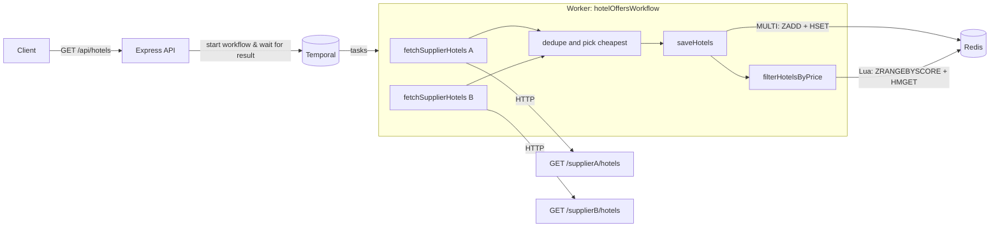

# Hotel Offer Orchestrator

Gets hotel offers from two suppliers, merges hotels that appear under the same name, and returns the cheapest offer for each hotel. Temporal runs the comparison workflow. Redis stores the merged list and handles price filtering.

**Stack:** Node.js 22 · TypeScript · Express 5 · Temporal · Redis · Docker Compose

---

## Contents

- [Quick start](#quick-start)
- [Architecture](#architecture)
- [API](#api)
- [How it works](#how-it-works)
- [Error handling, retries and logging](#error-handling-retries-and-logging)
- [Simulating a supplier outage](#simulating-a-supplier-outage)
- [Postman collection](#postman-collection)
- [Local development (without Docker)](#local-development-without-docker)
- [Tests](#tests)
- [Configuration](#configuration)
- [Deployment](#deployment)
- [Project structure](#project-structure)
- [Design decisions](#design-decisions)

---

## Quick start

Prerequisites: Docker with Compose v2 (`docker compose` or `docker-compose`).

```bash
docker compose up --build -d
```

This starts four containers:

| Service    | What it is                                                 | Host port                        |
| ---------- | ---------------------------------------------------------- | -------------------------------- |
| `api`      | Express API: `/api/hotels`, mock suppliers, `/health`      | `3000`                           |
| `worker`   | Temporal worker that runs the workflow and activities      | –                                |
| `temporal` | Temporal dev server and Web UI                             | `7233` (gRPC), `8233` (UI)       |
| `redis`    | Stores the deduplicated hotel lists                        | `6379`                           |

Try it:

```bash
curl -s localhost:3000/health | jq
curl -s "localhost:3000/api/hotels?city=delhi" | jq
curl -s "localhost:3000/api/hotels?city=delhi&minPrice=5000&maxPrice=10000" | jq
```

Open the Temporal UI at <http://localhost:8233> to see each search as a workflow run, with its activity attempts and retries.

> **Port already in use?** Copy `.env.example` to `.env` and change `API_PORT`, `REDIS_PORT`, `TEMPORAL_PORT` or `TEMPORAL_UI_PORT`. You can also set them inline, e.g. `API_PORT=3100 docker compose up -d`.

Stop everything:

```bash
docker compose down        # add -v to also delete the Redis volume
```

---

## Architecture



- The **API** validates the request, starts one Temporal workflow per search, waits for its result, and returns it. It also serves the two mock supplier endpoints.
- The **worker** runs the workflow. Anything that does I/O (HTTP calls to suppliers, Redis reads and writes) runs as an activity, so Temporal can retry it and record it in the workflow history.
- The API and worker are built from **one Docker image** and started with different commands.

---

## API

### `GET /api/hotels?city=<city>`

Returns one offer per hotel: the cheapest across suppliers, sorted by price ascending.

```bash
curl -s "localhost:3000/api/hotels?city=delhi"
```

```json
[
  { "name": "Lemon Tree",    "price": 3200,  "supplier": "Supplier B", "commissionPct": 9 },
  { "name": "Holtin",        "price": 5340,  "supplier": "Supplier B", "commissionPct": 20 },
  { "name": "Radison",       "price": 5900,  "supplier": "Supplier A", "commissionPct": 13 },
  { "name": "Hyatt Regency", "price": 7200,  "supplier": "Supplier A", "commissionPct": 11 },
  { "name": "The Leela",     "price": 9800,  "supplier": "Supplier B", "commissionPct": 16 },
  { "name": "ITC Maurya",    "price": 11000, "supplier": "Supplier A", "commissionPct": 14 },
  { "name": "Taj Palace",    "price": 11990, "supplier": "Supplier B", "commissionPct": 14 }
]
```

### `GET /api/hotels?city=<city>&minPrice=<min>&maxPrice=<max>`

Same search, filtered to an **inclusive** price range. The filter runs inside Redis. You can pass `minPrice` and `maxPrice` together or on their own.

```bash
curl -s "localhost:3000/api/hotels?city=delhi&minPrice=5000&maxPrice=10000"
```

```json
[
  { "name": "Holtin",        "price": 5340, "supplier": "Supplier B", "commissionPct": 20 },
  { "name": "Radison",       "price": 5900, "supplier": "Supplier A", "commissionPct": 13 },
  { "name": "Hyatt Regency", "price": 7200, "supplier": "Supplier A", "commissionPct": 11 },
  { "name": "The Leela",     "price": 9800, "supplier": "Supplier B", "commissionPct": 16 }
]
```

**Response headers**

| Header                    | Meaning                                                                    |
| ------------------------- | -------------------------------------------------------------------------- |
| `X-Workflow-Id`           | The Temporal workflow ID for this search; you can look it up in the UI.     |
| `X-Result-Count`          | Number of hotels returned.                                                  |
| `X-Suppliers-Unavailable` | Present only when a supplier failed and the result is partial.              |

The body stays a plain array, as the spec requires. Supplier failures are reported in the header, not in the body.

**Status codes**

| Status | When                                                                                        |
| ------ | ------------------------------------------------------------------------------------------- |
| `200`  | Success. Also returned for a city with no hotels (`[]`) and when only one supplier answered. |
| `400`  | Invalid query: `city` missing or malformed, prices not numbers or negative, `minPrice > maxPrice`. |
| `502`  | Every supplier failed, even after retries (`ALL_SUPPLIERS_UNAVAILABLE`).                     |
| `503`  | The API cannot reach Temporal (`WORKFLOW_ENGINE_UNAVAILABLE`).                               |
| `504`  | The workflow did not finish within `WORKFLOW_TIMEOUT_MS`, e.g. no worker is running (`SEARCH_TIMEOUT`). |

Errors use one format:

```json
{ "error": { "code": "VALIDATION_ERROR", "message": "Invalid query parameters",
             "details": [{ "field": "minPrice", "message": "minPrice must be less than or equal to maxPrice" }] } }
```

### Mock suppliers: `GET /supplierA/hotels`, `GET /supplierB/hotels`

These return static supplier data in the format from the spec. Add `?city=` to filter by city.

```json
[{ "hotelId": "a1", "name": "Holtin", "price": 6000, "city": "delhi", "commissionPct": 10 }]
```

| City        | Data                                                                                     |
| ----------- | ---------------------------------------------------------------------------------------- |
| `delhi`     | 5 hotels from both suppliers (one with the same price from both), plus 1 from each supplier only |
| `mumbai`    | 2 hotels from both suppliers, plus 1 from each supplier only                                |
| `bangalore` | Supplier A only                                                                           |
| anything else | No results                                                                              |

### `GET /health`

Reports the health of **both suppliers**, plus Redis, Temporal, and whether a worker is polling the task queue.

```json
{
  "status": "degraded",
  "timestamp": "2026-11-21T16:04:16.854Z",
  "uptimeSeconds": 22,
  "suppliers": {
    "Supplier A": { "status": "up",   "latencyMs": 7, "hotelCount": 11 },
    "Supplier B": { "status": "down", "latencyMs": 6, "error": "Supplier B responded with HTTP 503" }
  },
  "dependencies": {
    "redis":    { "status": "up", "latencyMs": 2 },
    "temporal": { "status": "up", "latencyMs": 3 },
    "worker":   { "status": "up", "latencyMs": 3, "pollers": 1 }
  }
}
```

| `status`   | Meaning                                                  | HTTP  |
| ---------- | -------------------------------------------------------- | ----- |
| `ok`       | Everything is up.                                        | `200` |
| `degraded` | One supplier is down; searches still work with partial results. | `200` |
| `down`     | Both suppliers are down, or Redis, Temporal or the worker is down. | `503` |

`GET /livez` is a simple liveness check, used by the container healthcheck.

### Outage simulation: `PUT /admin/suppliers/:supplierId/status`

Body: `{"status": "down"}` or `{"status": "up"}`. `GET /admin/suppliers` lists the current state. See [Simulating a supplier outage](#simulating-a-supplier-outage).

---

## How it works

### The workflow (`src/temporal/workflows.ts`)

`hotelOffersWorkflow({ city, minPrice?, maxPrice? })`:

1. **Calls both suppliers in parallel.** It runs one `fetchSupplierHotels` activity per supplier and waits for both with `Promise.allSettled`.
2. **Copes with a failed supplier.** If a supplier still fails after its retries, the workflow logs a warning, marks that supplier as `failed`, and continues with the other one. The workflow fails (`AllSuppliersUnavailable`) only if **every** supplier failed.
3. **Dedupes and picks the best offer.** This is `selectBestOffers` in `src/domain/selectBestOffers.ts`, a pure function that runs inside the workflow:
   - Hotels are matched by **normalized name** (trimmed, repeated spaces collapsed, case-insensitive), so `"The  Leela"` and `"the leela"` count as the same hotel.
   - If both suppliers list a hotel, the **lower price** wins.
   - On an **exact price tie**, the offer with the **higher `commissionPct`** wins (same price for the customer, better margin for us). If that also ties, the offer from the first supplier in the list wins.
   - If only one supplier lists a hotel, that offer is used.
   - The result is sorted by price ascending, then by name.
4. **Saves to Redis.** The `saveHotels` activity always saves the deduplicated list, with or without a price filter.
5. **Filters by price in Redis.** If `minPrice` and/or `maxPrice` was given, the `filterHotelsByPrice` activity runs the price query in Redis and returns its result.

### Redis data model (`src/store/hotelStore.ts`)

Each city uses two keys:

| Key                     | Type | Contents                                                        |
| ----------------------- | ---- | --------------------------------------------------------------- |
| `hotels:{city}:prices`  | ZSET | member = normalized hotel name, **score = best price**           |
| `hotels:{city}:offers`  | HASH | field = normalized hotel name, value = the offer as JSON          |

- **Save** runs in one `MULTI` transaction: `DEL` both keys, then `ZADD`, `HSET` and `EXPIRE` (TTL from `HOTELS_TTL_SECONDS`). Readers never see a half-written list, and a later search replaces the earlier one atomically.
- **Filter** is a Lua script that runs inside Redis:

  ```lua
  local names = redis.call('ZRANGEBYSCORE', KEYS[1], ARGV[1], ARGV[2])  -- price index, already sorted
  if #names == 0 then return {} end
  return redis.call('HMGET', KEYS[2], unpack(names))                    -- fetch the matching offers
  ```

  The range query uses the sorted-set index (O(log N + M)). It is atomic and needs one round trip. A missing bound becomes `-inf` or `+inf`.

Inspect the stored data:

```bash
docker compose exec redis redis-cli ZRANGE hotels:delhi:prices 0 -1 WITHSCORES
docker compose exec redis redis-cli HGETALL hotels:delhi:offers
```

---

## Error handling, retries and logging

**Supplier errors** (`src/suppliers/supplierClient.ts`, `src/temporal/activities.ts`) are sorted into three kinds. Each becomes a typed Temporal `ApplicationFailure`:

| Kind                  | Cause                                                    | Failure type              | Retried? |
| --------------------- | -------------------------------------------------------- | ------------------------- | -------- |
| unavailable           | Network error, timeout (`SUPPLIER_TIMEOUT_MS`), HTTP 5xx or 429 | `SupplierUnavailable`     | Yes      |
| rejected              | Other HTTP 4xx                                            | `SupplierRejected`        | No       |
| invalid response      | Not JSON, or the payload fails schema validation (zod)    | `SupplierInvalidResponse` | No       |

**Retry policies** (set in the workflow):

- Supplier calls: up to 3 attempts, 200 ms initial backoff, ×2, 5 s start-to-close timeout. Errors that are not worth retrying fail at once.
- Redis activities: up to 5 attempts with the same backoff.
- Note: the Temporal server rounds retry timers up to about 1 s, so a supplier that is down adds about 2 s to a request before the workflow continues without it.

The activity also uses Temporal's cancellation signal when it calls a supplier, so a cancelled or timed-out activity aborts its HTTP request.

**Workflow failures** are converted into API errors in `src/temporal/hotelSearchGateway.ts` (see the status code table above). Each search has a hard limit, `workflowExecutionTimeout` (`WORKFLOW_TIMEOUT_MS`), so a request never hangs, even with no worker running.

**Logging:** all logs are structured JSON from [pino](https://getpino.io).

- The API logs each request (`pino-http`) and each search with its workflow ID, number of results and failed suppliers.
- The worker passes Temporal SDK logs through pino. Workflow logs (`log` from `@temporalio/workflow`) and activity logs (`log` from `@temporalio/activity`) automatically include `workflowId`, `runId`, `activityType` and `attempt`.

```bash
docker compose logs -f worker
```

```json
{"level":"warn","time":"…","service":"hotel-worker","component":"temporal-worker","sdkComponent":"activity","workflowId":"hotel-search-delhi-…","activityType":"fetchSupplierHotels","attempt":2,"supplier":"Supplier B","kind":"unavailable","httpStatus":503,"msg":"Supplier request failed"}
{"level":"warn","time":"…","sdkComponent":"workflow","city":"delhi","supplier":"Supplier B","error":"Supplier B responded with HTTP 503","msg":"Supplier failed after retries; continuing without it"}
```

---

## Simulating a supplier outage

You can switch a supplier off and on while the stack is running:

```bash
# Take Supplier B down; its endpoint now returns 503
curl -X PUT localhost:3000/admin/suppliers/supplierB/status \
     -H 'content-type: application/json' -d '{"status":"down"}'

curl -si "localhost:3000/api/hotels?city=delhi"   # 200, Supplier A offers only, X-Suppliers-Unavailable: Supplier B
curl -s  localhost:3000/health | jq .status       # "degraded"

# Bring it back
curl -X PUT localhost:3000/admin/suppliers/supplierB/status \
     -H 'content-type: application/json' -d '{"status":"up"}'
```

You can also start with a supplier down: `SUPPLIER_B_DOWN=true docker compose up -d`.

---

## Postman collection

`postman/hotel-offer-orchestrator.postman_collection.json` (Postman v2.1). Import it into Postman and run it with the Collection Runner. Change the `baseUrl` collection variable if the API is not on `http://localhost:3000`.

| Folder                        | Requests                                                                                                                                            |
| ----------------------------- | --------------------------------------------------------------------------------------------------------------------------------------------------- |
| **Health**                    | Health with all components up                                                                                                                         |
| **Mock suppliers**            | Raw Supplier A and Supplier B responses                                                                                                               |
| **Hotels**                    | Delhi (overlapping hotels: checks dedupe, cheapest pick, sorting, response format), price range 5000–10000, `minPrice` only, Mumbai, **city with no results** (`paris` → `[]`), two validation errors |
| **Supplier down simulation**  | B down → health `degraded` → search returns Supplier A only → A down too → `502` → health `503` → restore both → health `ok`                         |

Every request has test assertions. Run the folders in order: the last folder changes supplier state and restores it at the end.

Command-line run: `npx newman run postman/hotel-offer-orchestrator.postman_collection.json`

---

## Local development (without Docker)

Requirements: Node.js ≥ 20.3 (22 LTS recommended), plus Temporal and Redis running somewhere.

```bash
npm install

# Start only the infrastructure in Docker…
docker compose up -d temporal redis
# …or natively: `temporal server start-dev` and `redis-server`

npm run dev:api      # terminal 1: http://localhost:3000 (tsx watch)
npm run dev:worker   # terminal 2: Temporal worker (tsx watch)
```

The defaults (`localhost:7233`, `redis://localhost:6379`, suppliers at `http://localhost:3000`) work without any configuration.

Production build: `npm run build && npm run start:api` / `npm run start:worker`.

---

## Tests

```bash
npm test
```

31 tests:

- `test/selectBestOffers.test.ts`: dedupe rules (cheapest wins, tie-breakers, name normalization, hotels from one supplier only, empty input).
- `test/api.test.ts`: query validation, mapping of error codes to HTTP status, response headers, mock supplier endpoints and outage switch, `/health` in the ok, degraded and down states. Temporal is replaced with a fake here.
- `test/workflow.test.ts`: the real workflow on Temporal's time-skipping test server, with mocked activities: parallel supplier calls, dedupe, saving to Redis, price filtering, retries (exactly 3 attempts) then continuing with the other supplier, all suppliers down, and the empty-city case.

> The workflow tests download Temporal's test server binary on first run, which needs network access.

---

## Configuration

| Variable                      | Default                  | Description                                                  |
| ----------------------------- | ------------------------ | ------------------------------------------------------------ |
| `PORT`                        | `3000`                   | API port inside the container or process                     |
| `LOG_LEVEL`                   | `info`                   | `trace` / `debug` / `info` / `warn` / `error` / `silent`     |
| `TEMPORAL_ADDRESS`            | `localhost:7233`         | Temporal frontend address                                    |
| `TEMPORAL_NAMESPACE`          | `default`                | Temporal namespace                                           |
| `TEMPORAL_TASK_QUEUE`         | `hotel-offers`           | Task queue shared by the API and the worker                  |
| `WORKFLOW_TIMEOUT_MS`         | `15000`                  | Maximum time for one search workflow                         |
| `REDIS_URL`                   | `redis://localhost:6379` | Redis connection URL                                         |
| `HOTELS_TTL_SECONDS`          | `3600`                   | TTL of the stored per-city lists                             |
| `SUPPLIER_BASE_URL`           | `http://localhost:3000`  | Base URL of the supplier APIs (`http://api:3000` in Compose) |
| `SUPPLIER_TIMEOUT_MS`         | `3000`                   | Timeout for each supplier HTTP call                          |
| `SUPPLIER_HEALTH_TIMEOUT_MS`  | `2000`                   | Timeout for each `/health` check                             |
| `SUPPLIER_A_DOWN` / `SUPPLIER_B_DOWN` | `false`          | Start with that mock supplier down                           |
| `API_PORT`, `REDIS_PORT`, `TEMPORAL_PORT`, `TEMPORAL_UI_PORT` | `3000`, `6379`, `7233`, `8233` | Host ports published by Compose |

---

## Deployment

### Free: Render (single container)

Render's free plan allows one web service with 512 MB RAM and 0.1 CPU, and has no free background workers. So `Dockerfile.render` packs everything into **one container**:

- Redis
- the Temporal dev server, with its web UI off
- one Node process that runs both the API and the worker

`scripts/render-start.sh` starts them and stops the container if any of them exits, so Render restarts it. Under the free plan's limits this uses about 220 MB of RAM. `render.yaml` describes the service for Render.

1. Sign in at <https://render.com> with GitHub. The free plan needs no card.
2. **New → Blueprint**, select this repository, then **Apply**. Render reads `render.yaml` and builds `Dockerfile.render`. The first build takes about 5–10 minutes.
3. The app is then live at `https://hotel-offer-orchestrator.onrender.com`. Render adds a suffix if that name is taken; the dashboard shows the real URL.
   - `https://<your-app>.onrender.com/health`
   - `https://<your-app>.onrender.com/api/hotels?city=delhi`
4. **Keep it awake.** Free services sleep after 15 minutes without traffic. Create a free job at <https://cron-job.org> that calls `https://<your-app>.onrender.com/livez` every 10 minutes.

Limits of the free plan:

- **Slower responses.** With 0.1 CPU, the first search after a start takes a few seconds; after that, searches take about 0.5–2 s.
- **Data resets on restart.** Redis and Temporal keep their data in memory, so it is lost when the service restarts or redeploys. That doesn't affect results, because every search fetches fresh data and saves it again.
- **Hour limit.** One always-on service uses about 744 of the 750 free hours a month, so don't run a second free service in the same Render workspace.
- **Public admin switch.** `/admin/suppliers/*` is open to anyone on a public URL. If someone leaves a supplier down, switch it back on with `PUT /admin/suppliers/<id>/status` and `{"status":"up"}`.

### Any Docker host (docker compose)

The full multi-container stack runs with Compose on any Docker host (a VM on EC2, GCE, DigitalOcean, etc.) with at least 2 GB RAM:

```bash
git clone <this-repo> && cd <this-repo>
cp .env.example .env          # optional: adjust ports / log level
docker compose up --build -d
docker compose ps             # temporal, redis and api should be "healthy"
curl -s localhost:3000/health
```

To build and publish the image to a registry:

```bash
docker build -t <registry>/hotel-offer-orchestrator:1.0.0 .
docker push <registry>/hotel-offer-orchestrator:1.0.0
# API:    docker run … <image>                                  (default CMD)
# Worker: docker run … <image> node dist/temporal/worker.js
```

**Before going to production:**

- Replace the Temporal **dev server** with Temporal Cloud or a self-hosted cluster backed by PostgreSQL or Cassandra, then point `TEMPORAL_ADDRESS` (and TLS/API key settings) at it.
- Use a managed Redis (ElastiCache, Memorystore, Upstash, …) via `REDIS_URL`.
- Scale **workers** horizontally; they are stateless and share the task queue. Scale API replicas behind a load balancer.
- Point `SUPPLIER_BASE_URL` (or per-supplier URLs) at the real supplier APIs, and remove or protect the `/admin` outage switch.

---

## Project structure

```
src/
├── api/
│   ├── app.ts                  # Express app setup (middleware, routers, error handling)
│   ├── server.ts               # API entrypoint: Redis, Temporal gateway, graceful shutdown
│   ├── errors.ts               # HttpError, 404 handler, central error → HTTP mapping
│   └── routes/
│       ├── hotels.ts           # GET /api/hotels (zod validation)
│       └── health.ts           # GET /health, GET /livez
├── domain/
│   └── selectBestOffers.ts     # pure dedupe and best-offer logic (runs inside the workflow)
├── store/
│   └── hotelStore.ts           # Redis ZSET + HASH model, MULTI save, Lua price filter
├── suppliers/
│   ├── registry.ts             # supplier definitions (ids, names, paths)
│   ├── mockData.ts             # static supplier inventories
│   ├── mockRouter.ts           # GET /supplierX/hotels + outage simulation endpoints
│   └── supplierClient.ts       # HTTP client: timeout, error classification, payload validation
├── temporal/
│   ├── workflows.ts            # hotelOffersWorkflow
│   ├── activities.ts           # fetchSupplierHotels, saveHotels, filterHotelsByPrice
│   ├── worker.ts               # worker entrypoint (pino-backed Temporal logger)
│   └── hotelSearchGateway.ts   # Temporal client wrapper used by the API
├── scripts/
│   └── bundleWorkflows.ts      # build step: pre-bundles workflow code into dist/workflow-bundle.js
├── allInOne.ts                 # API + worker in one process (single-container hosting)
├── config.ts                   # environment-based configuration
├── logger.ts                   # pino logger
└── types.ts                    # shared types
test/                           # vitest: unit, API and Temporal workflow tests
postman/                        # Postman collection
Dockerfile                      # multi-stage build; one image for API and worker
docker-compose.yml              # temporal, redis, api, worker
Dockerfile.render               # single-container image (Redis + Temporal + API/worker) for free hosting
scripts/render-start.sh         # starts and supervises the three processes in that container
render.yaml                     # Render Blueprint (one free web service)
```

---

## Design decisions

- **Every search runs the workflow and gets fresh prices.** Redis is the store the spec asks for, and the price filter runs against it. It is not used as a cache that skips calling the suppliers. Adding a cache is easy: check whether `hotels:{city}:prices` exists before starting the workflow.
- **Each search saves its own result.** A price-filtered search for a city saves the full deduplicated list first and then filters it. Because the save is atomic, two searches for the same city at once both leave a complete list in Redis.
- **Partial results are better than no results.** If one supplier is down, the search returns the other supplier's offers (marked in a response header). The search fails only if no supplier answers.
- **The workflow has no I/O.** All HTTP and Redis calls are activities. The dedupe logic is a pure function that the workflow and the unit tests both use.
- **The workflow ID is `hotel-search-{city}-{uuid}`.** Each request gets its own run, which is easy to find in the Temporal UI from the `X-Workflow-Id` header.
- **City input is limited** to letters, spaces, `.`, `'` and `-`, up to 60 characters, and is lower-cased. This keeps Redis key names predictable.
